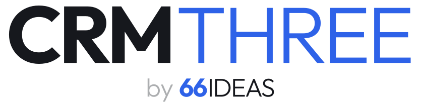
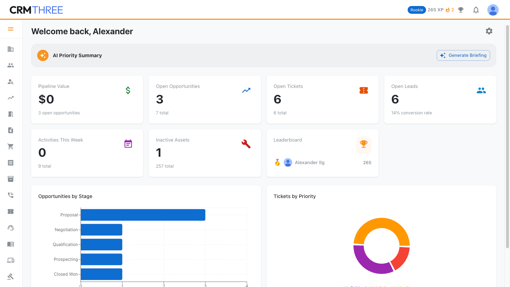
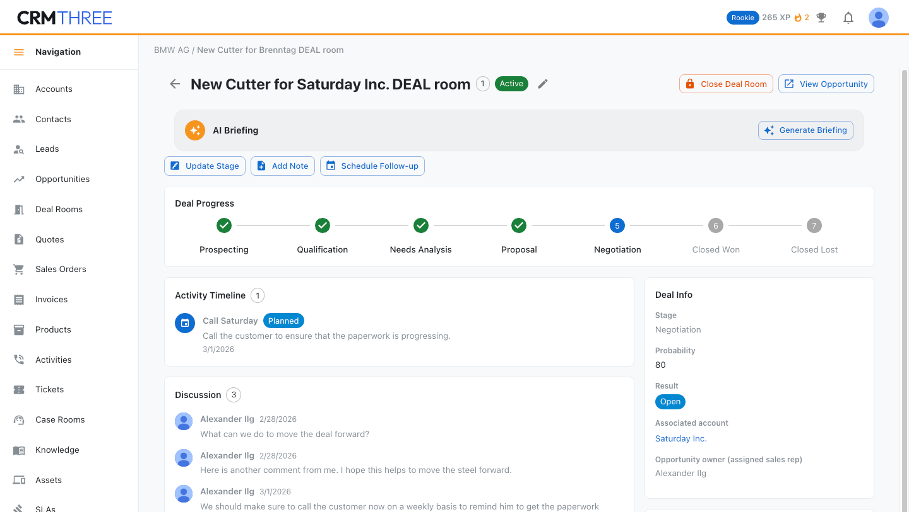

  <picture>
    <source media="(prefers-color-scheme: dark)" srcset="assets/crmthree-by-dark.svg">
    
  </picture>

  
  
  

**CRMTHREE is a complete CRM, published as an open-source specification with a working
reference implementation.** Accounts, contacts, leads, opportunities, quotes, orders,
invoices, tickets, SLAs, knowledge base, deal rooms, AI briefings, gamification - the
functionality, the UX, and the architecture, written down so that anyone can build it.

The idea, in one line: **the specification is the product; the code is the proof.**
Take the spec and build CRMTHREE on the stack you trust - or run the reference
implementation as-is.

## Repository layout

| Path | What it is |
|---|---|
| [`specs/`](specs/) | **The product.** Functional specification, UX specification, architecture, and data model |
| [`implementations/firebase/`](implementations/firebase/) | **The proof.** The canonical reference implementation: React + Firebase (Hosting, Auth, Firestore, Cloud Functions), self-hostable. **Implemented by Claude** |
| [`implementations/postgres/`](implementations/postgres/) | **The second proof.** The same spec on a stack that shares nothing with the first: Svelte 5 + SvelteKit + PostgreSQL, authorization in the database, no vendor - runs on a laptop and deploys unchanged to any Node + Postgres host. **Implemented by Claude** |
| [`implementations/rails/`](implementations/rails/) | **The third proof.** Ruby on Rails 8 + Hotwire + SQLite: server-rendered, one process, self-contained on any machine that runs Ruby. **Implemented by Codex** |
| `implementations/…` | Room for further implementations on other stacks - UI5, Azure, or yours |

## The specification

- [`specs/specifications.md`](specs/specifications.md) - functional spec: 60+ user stories with acceptance criteria
- [`specs/ux.md`](specs/ux.md) - UX spec: layouts, navigation, interaction patterns
- [`specs/architecture.md`](specs/architecture.md) - the technology-independent core: delivery model, product package, and the nine capabilities every implementation must provide
- [`specs/firebase.architecture.md`](specs/firebase.architecture.md) / [`specs/postgres.architecture.md`](specs/postgres.architecture.md) - how each stack realises them, including each implementation's deliberate divergences
- [`specs/data-model.json`](specs/data-model.json) - the complete data model, machine-readable
- [`specs/styles/`](specs/styles/) - visual style guides (light and dark)

The spec is written to be consumed by humans **and by AI agents**: acceptance criteria are
concrete, the data model is machine-readable, and nothing depends on tribal knowledge.

## Screenshots (reference implementation)

## Run an implementation

- **Firebase (reference):** see [`implementations/firebase/README.md`](implementations/firebase/README.md) -
  create a Firebase project, copy two config examples, `npm install`, deploy.
- **Postgres (no vendor):** see [`implementations/postgres/README.md`](implementations/postgres/README.md) -
  `createdb`, one apply script, `npm run dev` - against a local Postgres or any hosted one.
- **Rails (self-contained):** see [`implementations/rails/README.md`](implementations/rails/README.md) -
  `bin/setup`, one bootstrap command, `bin/dev`. SQLite travels with the app.

Three implementations, one specification: that is the thesis demonstrated rather than
claimed. Building the second one fed corrections back into the spec - the divergence
sections in the architecture documents record what each stack taught it.

## Contributing

- **Issues are welcome everywhere** - on the specs and on the implementations.
- **Pull requests are welcome on the specifications.** The reference implementations
  follow the specs. No CLA, no paperwork - see [CONTRIBUTING.md](CONTRIBUTING.md).

## License

[MIT](LICENSE) - free to use, free to build on, free to sell what you build.

---

A <a href="https://66ideas.com">66IDEAS</a> product · WENIGER. ABER BESSER.

